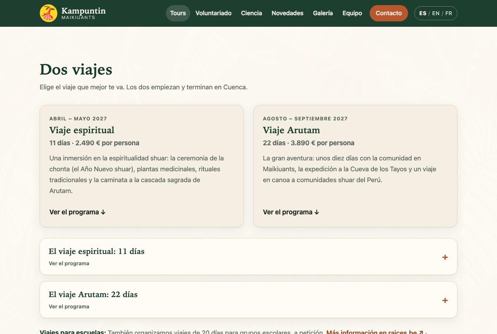
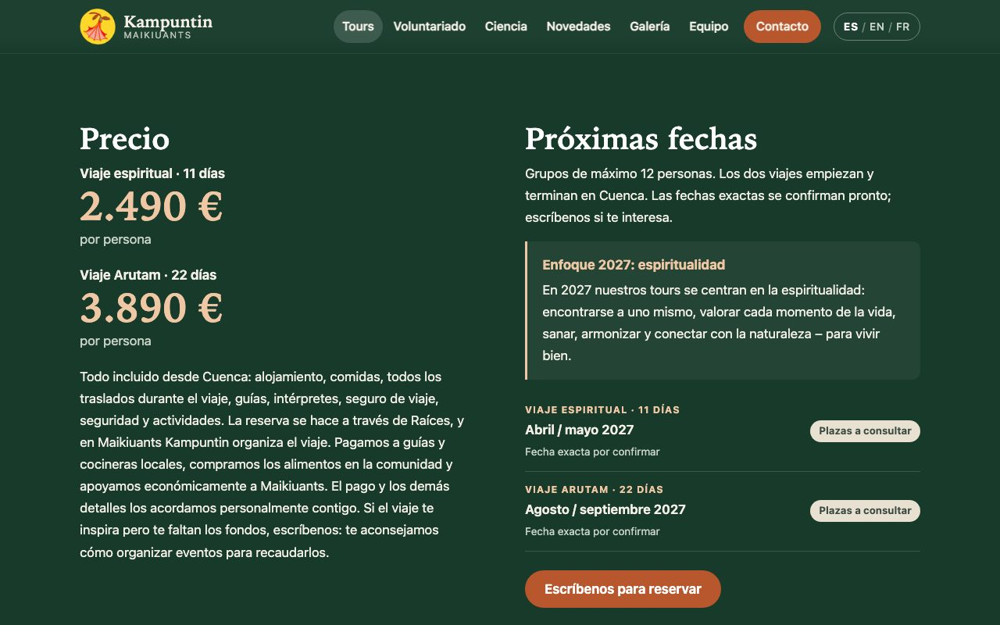
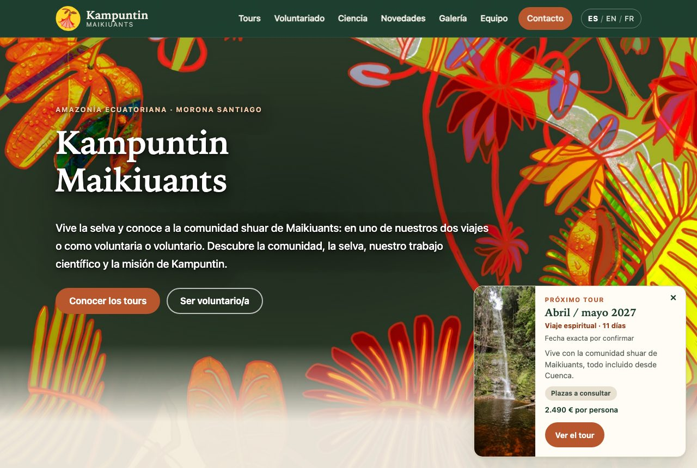
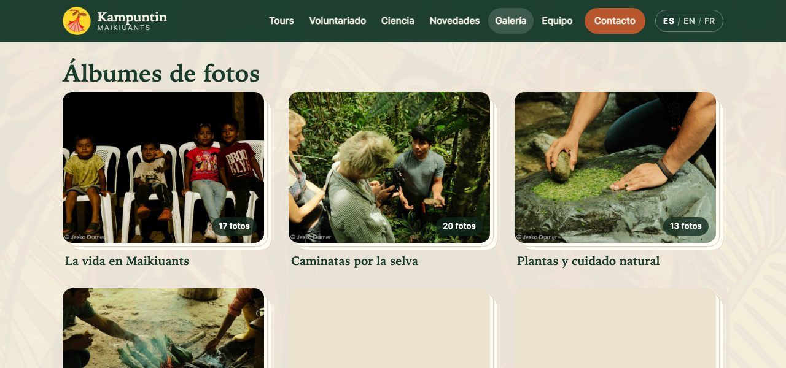
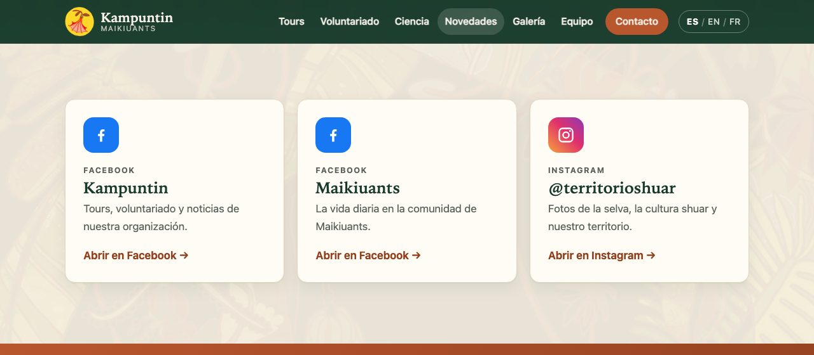
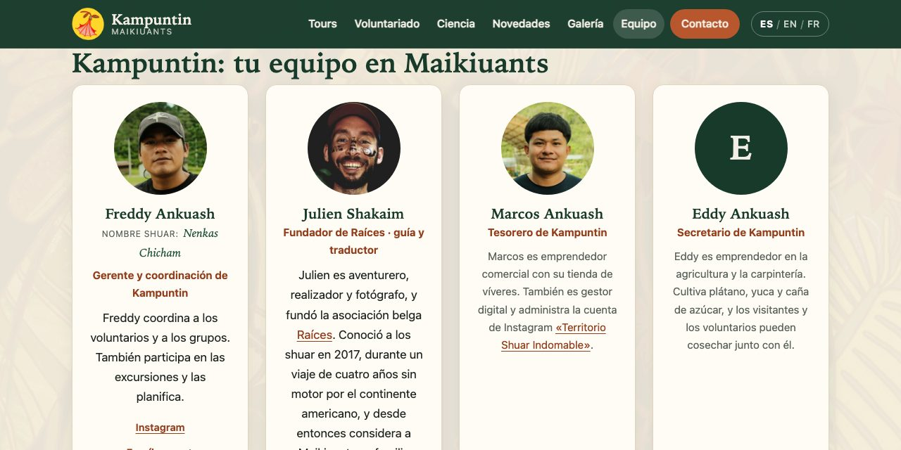

# Manual de la página web – Kampuntin Maikiuants

Cómo actualizar tours, galerías y novedades, paso a paso. Para personas sin conocimientos técnicos.

Página web: https://kampuntin-maikiuants.github.io · Este manual también como PDF para imprimir: [español](manual/Manual-pagina-web-ES.pdf) · [English](manual/Website-handbook-EN.pdf) · Notas técnicas para quien administra la página (en alemán): [manual/Technik-DE.md](manual/Technik-DE.md)

**Contenido**

- [1. Antes de empezar](#1-antes-de-empezar)
- [2. Tours: fechas, plazas y aviso en la página de inicio](#2-tours-fechas-plazas-y-aviso-en-la-página-de-inicio)
- [3. Galería: álbumes y fotos](#3-galería-álbumes-y-fotos)
- [4. Novedades: Facebook e Instagram](#4-novedades-facebook-e-instagram)
- [5. Equipo, textos y otras cosas útiles](#5-equipo-textos-y-otras-cosas-útiles)
- [6. Una dirección propia (dominio)](#6-una-dirección-propia-dominio)
- [7. Si algo sale mal](#7-si-algo-sale-mal)

## 1. Antes de empezar

La página web de Kampuntin no necesita un servidor propio. Todos los textos, fotos y fechas están guardados en **GitHub**, un servicio gratuito. Cada vez que alguien guarda un cambio allí, la página se actualiza sola en uno a tres minutos.


### 1.1 Las dos herramientas

| Herramienta | Para qué | Dirección |
|---|---|---|
| **GitHub** | Todos los archivos de la página: textos, fotos, álbumes y ajustes. | github.com/Kampuntin-Maikiuants/Kampuntin-Maikiuants.github.io |
| **Pages CMS** | Un formulario sencillo para las fechas de los tours y las plazas libres. Funciona también desde el celular. | app.pagescms.org |


### 1.2 Crear tu acceso (una sola vez)

1. Crea una cuenta gratuita en **github.com** (botón «Sign up»). Usa un correo que revises con frecuencia.
2. Envía tu nombre de usuario de GitHub a la persona que administra la página (hoy: Jesko Dorner).
3. Esa persona te invita en GitHub: en el repositorio «Settings» › «Collaborators» › «Add people».
4. Recibirás un correo de GitHub. Haz clic en «Accept invitation». Desde ese momento puedes editar.

> **Consejo:** GitHub está en inglés. En este manual los nombres de los botones aparecen entre comillas, tal como los ves en la pantalla, por ejemplo «Add file» o «Commit changes».


### 1.3 Cómo se edita un archivo en GitHub

1. Abre **github.com/Kampuntin-Maikiuants/Kampuntin-Maikiuants.github.io** e inicia sesión («Sign in»).
2. Haz clic en las carpetas hasta llegar al archivo, por ejemplo `_data` › `es` › `home.yml`.
3. Arriba a la derecha del archivo haz clic en el lápiz («Edit this file»).
4. Cambia el texto.
5. Haz clic en el botón verde «Commit changes…». En la ventana escribe en una línea qué cambiaste (por ejemplo «Nuevo precio del viaje Arutam») y confirma con «Commit changes».
6. Espera uno a tres minutos y recarga la página web. Listo.


### 1.4 ¿Ya está publicado?

En GitHub, la pestaña «Actions» muestra cada actualización de la página:

- **Círculo amarillo:** la página se está actualizando.
- **Marca verde:** listo, el cambio está en línea.
- **Cruz roja:** algo salió mal. La página sigue mostrando la versión anterior. Ver capítulo 7.

> **Consejo:** Si no ves el cambio, recarga la página con fuerza: en la computadora Ctrl + F5 (en Mac: Cmd + Shift + R).


### 1.5 Tres idiomas

La página existe en español, inglés y francés. Casi todos los textos están en tres archivos con el mismo nombre en las carpetas `_data/es`, `_data/en` y `_data/fr`. **Cambia siempre los tres.** Si no sabes traducir, cambia el español y pide ayuda para los otros idiomas, o usa un traductor como DeepL.


### 1.6 Reglas de oro para los archivos .yml

Los textos están en archivos con la terminación `.yml`. Son fáciles de leer, pero hay que respetar algunas reglas:

- No borres los espacios al principio de las líneas. La sangría indica qué pertenece a qué.
- Usa espacios, nunca la tecla Tab.
- Si un texto contiene dos puntos seguidos de un espacio, ponlo entre comillas: `"Viaje Arutam: 22 días"`.
- Para agregar algo nuevo, copia un bloque que ya existe, pégalo justo debajo y cambia los textos.
- Las líneas que empiezan con `#` son notas para quien edita. No aparecen en la página.


## 2. Tours: fechas, plazas y aviso en la página de inicio


### 2.1 Cómo funciona

Hay dos viajes: el **Viaje espiritual** (11 días) y el **Viaje Arutam** (22 días). La reserva se hace a través de Raíces; en Maikiuants, Kampuntin organiza el viaje. El nombre, la duración, el precio y la descripción de cada viaje se guardan una sola vez. Las fechas se guardan aparte, y cada fecha dice a qué viaje pertenece.


_La sección «Dos viajes» en la página de tours. Abajo se pueden abrir los programas._

- **Fechas y plazas:** archivo `_data/tour_dates.yml`. Lo más fácil es usar Pages CMS (2.2).
- **Nombre, duración, precio y texto de cada viaje:** `_data/es/tours.yml` (y `en`, `fr`), bajo `trips` (2.5).
- **El aviso en la página de inicio** toma la próxima fecha automáticamente (2.4).


### 2.2 Agregar una fecha nueva (con Pages CMS)

1. Abre **app.pagescms.org** e inicia sesión con «Sign in with GitHub».
2. Elige el repositorio **Kampuntin-Maikiuants.github.io**.
3. En el menú de la izquierda haz clic en **Fechas de tours**.
4. Debajo de la última fecha, haz clic en el botón para agregar una entrada nueva (signo +).
5. Llena los campos (ver la tabla).
6. Haz clic en «Save». En uno a tres minutos la fecha aparece en la página de tours y, si es la próxima, también en el aviso de la página de inicio.

| Campo | Qué escribir |
|---|---|
| Inicio | Primer día del viaje (exacto o aproximado). |
| Fin | Último día del viaje. |
| Viaje | Viaje espiritual (11 días) o Viaje Arutam (22 días). |
| Texto en vez de la fecha | Solo si la fecha aún no es exacta, por ejemplo «Abril / mayo 2027». En español, inglés y francés. |
| Nota pequeña | Opcional, una línea debajo de la fecha, por ejemplo «Fecha exacta por confirmar». |
| Plazas libres | Cuántas plazas quedan. **0** = Completo. Vacío = se usa el Estado. |
| Estado | Plazas a consultar · Plazas libres · Últimas plazas · Completo (solo si «Plazas libres» está vacío). |


_Así se ven los precios y las próximas fechas en la página de tours._

> **Consejo:** Las fechas pasadas desaparecen solas: cuando llega el día de inicio, la fecha ya no se muestra (la página se actualiza cada 6 horas). No hace falta borrarlas, pero puedes hacerlo para mantener la lista ordenada.


### 2.3 Actualizar las plazas libres

1. Abre Pages CMS › **Fechas de tours**.
2. En la fecha del viaje escribe en **Plazas libres** cuántas quedan (por ejemplo 12, y después de cada reserva un número menos).
3. Haz clic en «Save». Con 3 plazas o menos el número se muestra en naranja; con **0** aparece «Completo».

Una fecha completa ya no aparece en el aviso de la página de inicio. El aviso muestra entonces la siguiente fecha con plazas.


### 2.4 El aviso (pop-up) en la página de inicio


_El aviso aparece abajo a la derecha, unos segundos después de abrir la página de inicio._

El aviso muestra siempre la próxima fecha que todavía no pasó y que no está completa, con el nombre del viaje, la duración y el precio. **No hay que cambiar nada para que se actualice.**

**Encender o apagar el aviso:**

1. En GitHub abre el archivo `_config.yml` (está en la carpeta principal) y haz clic en el lápiz.
2. Busca la línea `tour_popup: true`.
3. Escribe `false` para apagarlo o `true` para encenderlo y guarda con «Commit changes».

**Cambiar el texto o la foto del aviso:** en `_data/es/home.yml` (y `en`, `fr`), al final, en el bloque `tour_popup`. La foto (`image`) es una ruta a un archivo de la página.

`_data/es/home.yml`
```yaml
tour_popup:
  eyebrow: Próximo tour
  text: >-
    Vive con la comunidad shuar de Maikiuants, todo incluido desde Cuenca.
  per: por persona
  button: Ver el tour
  close: Cerrar
  image: /assets/img/fotos/cascada.jpg
```


### 2.5 Cambiar el precio, la duración o la descripción de un viaje

1. En GitHub abre `_data/es/tours.yml` y haz clic en el lápiz.
2. Busca `trips:`. Debajo están `espiritual` y `arutam`.
3. Cambia `amount` (precio), `days` (duración), `when` (temporada) o `text` (descripción corta).
4. Haz lo mismo en `_data/en/tours.yml` y `_data/fr/tours.yml`.
5. Guarda con «Commit changes».

`_data/es/tours.yml` (fragmento)
```yaml
  espiritual:
    name: Viaje espiritual
    days: 11 días
    when: Abril – mayo 2027
    amount: "2.490 €"
    text: >-
      Una inmersión en la espiritualidad shuar: la ceremonia de la chonta (el Año Nuevo shuar),
      plantas medicinales, rituales tradicionales y la caminata a la cascada sagrada de Arutam.
    link: Ver el programa
```

El programa detallado (llegada, actividades y regreso) está en el mismo archivo: en `spiritual` para el viaje espiritual y en `experience` para el viaje Arutam.

> **Importante:** Un viaje completamente nuevo (un tercer tipo de viaje) necesita un pequeño cambio técnico en la página. Para eso, contacta a la persona que administra la página.


## 3. Galería: álbumes y fotos


### 3.1 Cómo funciona

Cada álbum es una **carpeta** dentro de `assets/galeria`. Todas las fotos de la carpeta aparecen en el álbum. La primera foto (o la que elijas) es la portada. Los álbumes se ordenan por el nombre de la carpeta, de mayor a menor: por eso cada carpeta empieza con un número. Los tres primeros álbumes aparecen también abajo en la página de tours.


_La galería: cada tarjeta es un álbum. Un clic abre todas las fotos._

Las carpetas actuales van de `01` a `10`. Un álbum nuevo recibe el número siguiente (`11`, `12`, …) para aparecer primero.


### 3.2 Preparar las fotos

- Formato **JPG**.
- Unos **1600 píxeles de ancho** y menos de **500 KB** por foto. Las fotos grandes hacen lenta la página.
- Para achicar fotos gratis: **squoosh.app** en el navegador, o una app para reducir fotos en el celular.
- Nombres sencillos, sin espacios ni acentos: `001.jpg`, `002.jpg`, … El orden de los números es el orden en el álbum.
- Pide permiso a las personas que aparecen en las fotos.


### 3.3 Crear un álbum nuevo

1. En GitHub abre la carpeta `assets` › `galeria`.
2. Haz clic en «Add file» › «Create new file».
3. En el campo del nombre escribe el nombre de la carpeta, una barra `/` y `_LEEME.txt`, por ejemplo: `11-fiesta-de-la-chonta-2027/_LEEME.txt`. Al escribir la barra, GitHub crea la carpeta.
4. En el contenido escribe una línea, por ejemplo «Álbum Fiesta de la Chonta 2027». Haz clic en «Commit changes…» y luego en «Commit changes».


### 3.4 Subir las fotos

1. Abre la carpeta nueva (o un álbum que ya existe).
2. Haz clic en «Add file» › «Upload files».
3. Arrastra las fotos a la ventana o haz clic en «choose your files». Puedes subir varias a la vez.
4. Abajo haz clic en «Commit changes» y espera a que termine la subida.
5. En uno a tres minutos el álbum aparece en la galería.

> **Consejo:** El archivo `_LEEME.txt` no aparece en la página. Puedes dejarlo o borrarlo.


### 3.5 Título bonito y portada

Sin más datos, el álbum usa el nombre de la carpeta como título. Para un título en tres idiomas y una portada elegida, abre `_data/albums.yml`, copia un bloque arriba de la lista y cámbialo:

`_data/albums.yml` (ejemplo)
```yaml
- folder: 11-fiesta-de-la-chonta-2027
  title: { es: "Fiesta de la Chonta 2027", en: "Chonta festival 2027", fr: "Fête de la Chonta 2027" }
  cover: "004.jpg"
```

- `folder`: el nombre exacto de la carpeta.
- `title`: el título en los tres idiomas.
- `cover`: el nombre de la foto de portada. Vacío (`""`) = la primera foto.


### 3.6 Borrar una foto o un álbum

1. Abre la foto en GitHub.
2. Arriba a la derecha haz clic en los tres puntos «…» › «Delete file».
3. Confirma con «Commit changes». Un álbum desaparece cuando ya no tiene fotos.


## 4. Novedades: Facebook e Instagram


### 4.1 Qué se ve en la página Novedades


_Arriba aparecen las cuentas de Facebook e Instagram como tarjetas._

La página muestra las cuentas de Facebook e Instagram como tarjetas. Si la importación automática está configurada (4.3), debajo aparecen también las publicaciones más recientes con texto y fotos. Las tres últimas aparecen además en la página de inicio.

El muro de Facebook no se puede mostrar directamente: Facebook solo lo muestra a personas que tienen la sesión iniciada en Facebook, y las demás verían un cuadro vacío. Por eso la página **importa** las publicaciones.


### 4.2 Cambiar o agregar una cuenta

1. En GitHub abre `_config.yml` y haz clic en el lápiz.
2. Busca `social:`.
3. Cambia el nombre (`name`) o el enlace (`url`). Para otra cuenta de Facebook copia un bloque `- name: … url: …` y pégalo debajo.
4. Guarda con «Commit changes». La tarjeta aparece en Novedades y en el pie de página.

`_config.yml` (fragmento)
```yaml
social:
  instagram:
    handle: territorioshuar
    url: "https://www.instagram.com/territorioshuar/"
  facebook:
    - name: Kampuntin
      url: "https://www.facebook.com/profile.php?id=61576137841827"
    - name: Maikiuants
      url: "https://www.facebook.com/profile.php?id=61566774571229"
```


### 4.3 Mostrar las publicaciones automáticamente

Se configura una sola vez y toma unos 20 minutos. Después, la página busca publicaciones nuevas cada 6 horas, sola.

> **Importante:** Requisitos: tienen que ser **páginas de Facebook** (no perfiles personales) y quien lo configura tiene que ser administrador de esas páginas. Para Instagram, la cuenta tiene que ser profesional (empresa o creador) y estar vinculada a una de las páginas de Facebook.

1. Entra en **developers.facebook.com** con la cuenta de Facebook que administra las páginas. «My Apps» › «Create App», tipo «Business», nombre por ejemplo «Kampuntin Website».
2. Abre «Tools» › «Graph API Explorer» y elige arriba la app nueva. En «Permissions» agrega `pages_show_list` y `pages_read_engagement`, y para Instagram también `instagram_basic` y `business_management`. Luego «Generate Access Token» y confirma.
3. Abre «Tools» › «Access Token Debugger», pega el token, haz clic en «Debug» y abajo en «Extend Access Token». Copia el token largo.
4. Vuelve al Graph API Explorer, pega el token largo y ejecuta la consulta `me/accounts`. La respuesta tiene un `access_token` para cada página. Estos tokens de página no vencen.
5. En GitHub, en el repositorio: «Settings» › «Secrets and variables» › «Actions» › «New repository secret». Nombre: `FB_PAGE_TOKENS`. Valor: los tokens de página, uno por línea. Guarda con «Add secret».
6. Pestaña «Actions» › «Website bauen & Social Media importieren» › «Run workflow». En uno a tres minutos aparecen las publicaciones.


### 4.4 ¿Funciona la importación?

En «Actions» abre la última ejecución. Arriba, en «Annotations», hay un mensaje corto (en alemán):

- Amarillo «Kein Secret FB_PAGE_TOKENS gesetzt»: falta el paso 5.
- Rojo «Token Nr. 1: …»: el token es incorrecto o venció. Al lado está el mensaje de Facebook.
- Azul «… Beiträge geladen»: todo bien.

> **Consejo:** Si alguien cambia la contraseña de Facebook o quita los permisos de la app, los tokens dejan de funcionar: repite los pasos 2 a 5. Si en el repositorio no pasa nada durante 60 días, GitHub pausa la actualización automática: en «Actions» haz clic en «Enable workflow».


### 4.5 Mostrar una publicación de Instagram a mano

1. Abre la publicación en Instagram y copia el enlace, por ejemplo `https://www.instagram.com/p/ABC123/`.
2. En GitHub abre `_data/instagram_embeds.yml` y agrega una línea: `- https://www.instagram.com/p/ABC123/`
3. Guarda con «Commit changes». La publicación aparece en Novedades. Se carga recién al hacer clic, para proteger la privacidad de las visitas.


## 5. Equipo, textos y otras cosas útiles


### 5.1 Agregar o cambiar una persona del equipo


_Las tarjetas del equipo en la página «Equipo»._

1. Prepara una foto **cuadrada** (unos 600 × 600 píxeles, JPG) con la cara en el centro.
2. Súbela a `assets` › `img` › `equipo` con «Add file» › «Upload files», con un nombre sencillo, por ejemplo `eddy.jpg`.
3. Abre `_data/team.yml`, copia el bloque de una persona, pégalo y cámbialo (ver el ejemplo).
4. Guarda con «Commit changes».

`_data/team.yml` (ejemplo)
```yaml
- name: "Eddy Ankuash"
  group: kampuntin
  photo: "/assets/img/equipo/eddy.jpg"
  role: { es: "Secretario de Kampuntin", en: "Secretary of Kampuntin", fr: "Secrétaire de Kampuntin" }
  bio:
    es: "Texto corto en español."
    en: "Short text in English."
    fr: "Texte court en français."
```

- Opcional: `contact: true` muestra el enlace «Escríbenos» (solo para las personas de contacto).
- Opcional: `social:` agrega enlaces a Instagram o Facebook.
- Opcional: `shuar_name:` muestra el nombre shuar debajo del nombre.

> **Consejo:** Para cambiar una foto, sube la nueva con otro nombre (por ejemplo `eddy-2.jpg`) y cambia la línea `photo`. Así los navegadores muestran enseguida la foto nueva. Publica fotos y textos de personas solo con su permiso.


### 5.2 ¿Dónde está cada texto?

| Página | Archivo (en `_data/es`, `_data/en` y `_data/fr`) |
|---|---|
| Inicio | `home.yml` |
| Tours | `tours.yml` |
| Voluntariado | `volunteering.yml` |
| Ciencia | `science.yml` |
| Novedades | `updates.yml` |
| Galería (textos) | `gallery.yml` |
| Equipo (textos generales) | `people.yml` |
| Contacto | `contact.yml` |
| Aviso legal | `legal.yml` |
| Menú, botones y pie de página | `ui.yml` |

| Contenido compartido por los tres idiomas | Archivo |
|---|---|
| Personas del equipo | `_data/team.yml` |
| Fechas de los tours | `_data/tour_dates.yml` |
| Álbumes (títulos y portadas) | `_data/albums.yml` |
| Videos | `_data/videos.yml` |
| Especies amenazadas | `_data/species.yml` |
| Correo, WhatsApp, personas de contacto, redes sociales, aviso encendido o apagado | `_config.yml` |


### 5.3 Personas de contacto y WhatsApp

Las personas de la página de contacto y del pie de página están en `_config.yml`, bajo `contact:` › `people:`. Cada persona tiene nombre, función en tres idiomas, número de WhatsApp (solo cifras, con código de país, sin + ni espacios) y el teléfono tal como se muestra.

`_config.yml` (fragmento)
```yaml
    - name: Julien Shakaim
      role: { es: Contacto para visitantes internacionales, en: Contact for international visitors, fr: Contact pour les visiteurs internationaux }
      whatsapp: "32494860865"
      phone: "+32 494 86 08 65"
      email: "jdefourny.explore@gmail.com"
```


### 5.4 Videos

**Videos cortos** (MP4, menos de 50 MB): súbelos a `assets/video` y agrégalos en `_data/videos.yml` (copia un bloque con `file`, `poster`, `title` y `text`). **Videos largos:** súbelos a YouTube y escribe solo el código del video en `youtube:`, por ejemplo `AbCdEf12345` de `https://youtu.be/AbCdEf12345`.


### 5.5 Experiencias de voluntarios (testimonios)

![Las experiencias en la página de voluntariado. Hoy todavía son ejemplos con «[Nombre]».](manual/img/es-testimonios.jpg)
_Las experiencias en la página de voluntariado. Hoy todavía son ejemplos con «[Nombre]»._

En la página de voluntariado hay tarjetas con experiencias de personas que ya estuvieron en Maikiuants. Cada tarjeta tiene una cita corta que siempre se ve, el nombre, una línea pequeña (por ejemplo «Voluntaria · Alemania · 2026») y, si quieres, el relato completo para abrir y una foto pequeña.

1. Pide a la persona una cita corta (una a tres frases), cómo quiere aparecer (nombre, país, año), si quiere también un relato más largo y una foto. **Pide su permiso para publicarlo.**
2. Opcional, la foto: cuadrada, con la cara en el centro, unos 300 × 300 píxeles. Súbela a `assets` › `img` › `fotos` con «Add file» › «Upload files», por ejemplo como `testimonio-ana.jpg`.
3. En GitHub abre `_data/es/volunteering.yml` y haz clic en el lápiz. Busca `testimonials:` y debajo `items:`.
4. Cambia un bloque de ejemplo (los que tienen «[Nombre]») o copia un bloque completo, desde `- quote:` hasta antes del siguiente `- quote:`, y pégalo debajo. Cambia los textos (ver el ejemplo).
5. Haz lo mismo en `_data/en/volunteering.yml` y `_data/fr/volunteering.yml`, con el texto traducido.
6. Guarda con «Commit changes».

`_data/es/volunteering.yml` (ejemplo de un bloque)
```yaml
    - quote: >-
        Llegué para ayudar en el vivero y me fui habiendo aprendido muchísimo más.
      name: "Ana"
      meta: "Voluntaria · Alemania · 2026"
      photo: "/assets/img/fotos/testimonio-ana.jpg"
      text: |-
        Primer párrafo del relato.

        Segundo párrafo del relato.
```

- `quote`: la cita corta. Deja `>-` tal cual y escribe el texto en la línea de abajo, con la misma sangría.
- `name` y `meta`: el nombre y la línea pequeña debajo.
- `photo`: la ruta de la foto, o vacío (`""`) si no hay foto.
- `text`: el relato completo (opcional). Deja `|-` tal cual; una línea vacía separa los párrafos. Si no hay relato, borra las líneas de `text`; entonces no aparece el botón «Leer la experiencia completa».

> **Consejo:** Antes de publicar, borra o reemplaza los tres bloques de ejemplo con «[Nombre]». Para quitar una experiencia, borra su bloque completo. Por ahora las experiencias aparecen solo en la página de voluntariado; para tenerlas también en la página de tours, pide ayuda a quien administra la página.


## 6. Una dirección propia (dominio)

Hoy la página está en **kampuntin-maikiuants.github.io**. Con un dominio propio, por ejemplo **www.kampuntin.org**, la dirección es más corta y fácil de recordar. La página sigue gratis en GitHub; solo el dominio cuesta dinero.


### 6.1 Elegir y comprar el dominio

1. Elige un nombre y una terminación, por ejemplo `kampuntin.org`, `kampuntin.com` o `kampuntin.ec`. En la página del proveedor puedes comprobar si todavía está libre.
2. Cómpralo en un proveedor de dominios (registrador), por ejemplo Namecheap, Porkbun o Cloudflare. Para la terminación .ec también hay proveedores en Ecuador. Precio aproximado: 10 a 20 USD por año para .org o .com; otras terminaciones pueden costar más.
3. Registra el dominio a nombre de Kampuntin, con un correo de la organización, y activa la renovación automática. Si el dominio vence, la página deja de verse con esa dirección.

> **Importante:** Guarda bien los datos de acceso del proveedor y compártelos con una segunda persona de confianza. Sin acceso al proveedor no se puede renovar ni cambiar el dominio.


### 6.2 Conectar el dominio con la página (DNS)

En la cuenta del proveedor, abre la configuración de DNS del dominio (se llama «DNS», «DNS records» o «Zona DNS») y crea estas entradas:

| Tipo | Nombre (host) | Valor |
|---|---|---|
| A | @ | 185.199.108.153 |
| A | @ | 185.199.109.153 |
| A | @ | 185.199.110.153 |
| A | @ | 185.199.111.153 |
| CNAME | www | kampuntin-maikiuants.github.io |

Borra las otras entradas A o CNAME para `@` y `www` que el proveedor haya creado (por ejemplo para una página de espera).

> **Consejo:** Opcional, para conexiones IPv6: cuatro entradas AAAA para `@` con los valores `2606:50c0:8000::153`, `2606:50c0:8001::153`, `2606:50c0:8002::153` y `2606:50c0:8003::153`.


### 6.3 Activar el dominio en GitHub

1. En GitHub, en el repositorio: «Settings» › «Pages».
2. En «Custom domain» escribe tu dominio con www, por ejemplo `www.kampuntin.org`, y haz clic en «Save».
3. GitHub comprueba el DNS. Puede tardar desde unos minutos hasta 48 horas. Cuando aparece «DNS check successful», marca «Enforce HTTPS». Si la casilla todavía está gris, espera unas horas y vuelve a intentarlo.
4. Listo: la página se abre en la dirección nueva. La dirección antigua kampuntin-maikiuants.github.io lleva automáticamente a la nueva.

> **Consejo:** Recomendado: verifica el dominio en GitHub para que nadie más pueda usarlo con GitHub Pages. En la configuración de la organización Kampuntin-Maikiuants: «Settings» › «Pages» › «Add a domain», y sigue las instrucciones (es otra entrada DNS, de tipo TXT).


### 6.4 Después del cambio

- Cambia la dirección en los perfiles de Facebook e Instagram, en WWOOF, en los volantes y en los códigos QR.
- Si las vistas previas en WhatsApp o Facebook todavía muestran la dirección antigua, escribe la dirección nueva en `_config.yml`, en la línea `url:` (quita el `#` del principio), por ejemplo `url: "https://www.kampuntin.org"`.
- Un correo con el dominio (por ejemplo info@kampuntin.org) se puede agregar después con un servicio de correo. Muchos proveedores de dominios ofrecen reenvío de correo gratis.


## 7. Si algo sale mal

| Problema | Qué hacer |
|---|---|
| La página no cambia | Espera tres minutos y recarga con Ctrl + F5. Mira la pestaña «Actions»: ¿amarillo (trabajando), verde (listo) o rojo (error)? |
| Cruz roja en «Actions» | Casi siempre es un error en un archivo `.yml`: un espacio de más o de menos, o faltan comillas. Abre la ejecución roja: el mensaje dice el archivo y la línea. Corrige y guarda de nuevo. Mientras tanto la página sigue mostrando la última versión buena. |
| Borré algo por error | Nada se pierde. En GitHub abre el archivo › «History», abre la versión anterior, copia el texto y pégalo de nuevo con el lápiz. |
| Una foto no aparece | Revisa que el nombre en el archivo sea exactamente igual al de la foto, con mayúsculas y la terminación (`.jpg` no es lo mismo que `.JPG`). |
| Las publicaciones de Facebook ya no se actualizan | Ver 4.4. |

**Ayuda:** Jesko Dorner · jesko.dorner@gmail.com


### Hoja resumen

| Tarea | Dónde | Herramienta |
|---|---|---|
| Fecha de tour nueva, plazas | Fechas de tours | Pages CMS |
| Precio o texto de un viaje | `_data/es\|en\|fr/tours.yml` › `trips` | GitHub |
| Aviso encendido o apagado | `_config.yml` › `tour_popup` | GitHub |
| Texto o foto del aviso | `_data/es\|en\|fr/home.yml` › `tour_popup` | GitHub |
| Álbum nuevo, subir fotos | `assets/galeria/NN-nombre/` | GitHub |
| Título o portada de un álbum | `_data/albums.yml` | GitHub |
| Cuentas de Facebook e Instagram | `_config.yml` › `social` | GitHub |
| Publicaciones automáticas | Secret `FB_PAGE_TOKENS` | GitHub y Facebook |
| Publicación de Instagram a mano | `_data/instagram_embeds.yml` | GitHub |
| Persona del equipo | `_data/team.yml` y `assets/img/equipo` | GitHub |
| Personas de contacto | `_config.yml` › `contact` | GitHub |
| Videos | `_data/videos.yml` y `assets/video` | GitHub |
| Experiencia de voluntario | `_data/es\|en\|fr/volunteering.yml` › `testimonials` | GitHub |
| Dominio propio | Proveedor de dominios (DNS) y «Settings» › «Pages» | Proveedor y GitHub |
